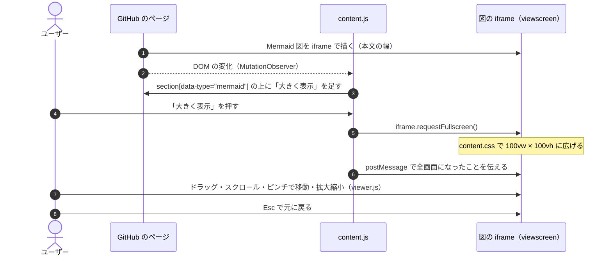

# GitHub Mermaid Wide

GitHub の Mermaid 図に「大きく表示」ボタンを付け、図を画面全体に表示する Chrome 拡張です。

GitHub は Mermaid 図を本文の幅の中に縮めて描くため、横に長いシーケンス図などは文字が小さくなって読みづらくなります。
この拡張では、図ごとにボタンを付けて、押すとその図だけを全画面で表示します。

## できること

- Issue・Pull Request・Markdown ファイルなどの Mermaid 図の上に「大きく表示」ボタンを付けます
- ボタンを押すと、図を画面全体に表示します。`Esc` で元に戻ります
- 全画面のあいだは、図を地図のように動かせます
  - 移動: ドラッグ、スクロール（トラックパッドの横スワイプ、Shift + ホイールで横）、矢印キー（Shift で大きく）
  - 拡大・縮小: ピンチ、⌘ / Ctrl + スクロール（カーソルの位置を中心に）、ダブルクリックで 2 倍（Shift で 1/2）、`+` / `-`
  - `0` で全体を表示、`1` で等倍。画面下のツールバーからも操作できます
- ページを読み直さない画面遷移や、あとから読み込まれたコメントの図にもボタンを付けます

## インストール

Chrome ウェブストアには公開していないので、パッケージ化されていない拡張として読み込みます。

1. このリポジトリを clone するか、ダウンロードして展開します
2. Chrome で `chrome://extensions` を開きます
3. 右上の「デベロッパーモード」をオンにします
4. 「パッケージ化されていない拡張機能を読み込む」を押し、このディレクトリを選びます
5. GitHub のページを開き直します

ファイルを変更したら、`chrome://extensions` でこの拡張の更新ボタンを押してから、ページを再読み込みしてください。

## 仕組み



この README を GitHub で開くと、上の図にもボタンが付きます（動作確認にどうぞ）。

- GitHub は Mermaid 図を `section[data-type="mermaid"]` の中の iframe（別ドメイン）で描いています
- ボタンを押すと、その iframe に [Fullscreen API](https://developer.mozilla.org/docs/Web/API/Fullscreen_API) の `requestFullscreen()` を呼び、`content.css` で `100vw × 100vh` に広げます
  - `position: fixed` で広げる方法は、祖先の要素の `transform` などに閉じ込められて本文の幅にしかなりません
  - 外側の `section` を全画面にする方法は、途中の要素の高さに縛られて図が途中で切れます
- iframe の中では `viewer.js` が動き、全画面のあいだだけ svg を `transform` で動かします。iframe の中からは全画面になったか分からないので、`content.js` が `postMessage` で伝えます
- `MutationObserver` で DOM の変化を見て、新しく出てきた図にもボタンを付けます

## 権限

`https://github.com/*` と、図を描く iframe の `https://viewscreen.githubusercontent.com/*` だけでコンテンツスクリプトを動かします。そのほかの権限は使わず、通信もしません。

## 制限

- GitHub の DOM 構造（`section[data-type="mermaid"]` と、その中の iframe）に依存しています。GitHub 側の変更で動かなくなることがあります
- 全画面での操作は、iframe の中の svg を `transform` で動かしています。GitHub が iframe の中の作りを変えると動かなくなることがあります
- Chrome の起動時に、デベロッパーモードの拡張について警告が出ることがあります

## ファイル構成

```
manifest.json   拡張の定義（Manifest V3）
content.js      ボタンを付けて、図の iframe を全画面にする処理
content.css     全画面にした iframe の大きさ
viewer.js       iframe の中で、全画面のあいだの移動・拡大縮小を受け持つ処理
viewer.css      全画面のあいだのツールバーとカーソル
```
